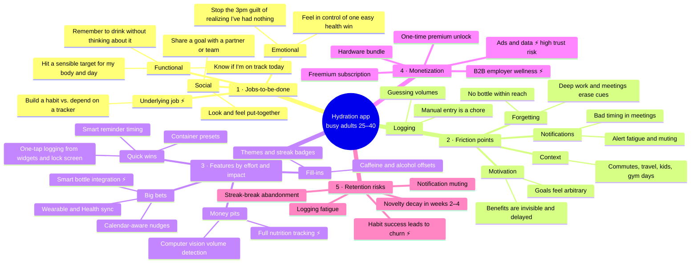
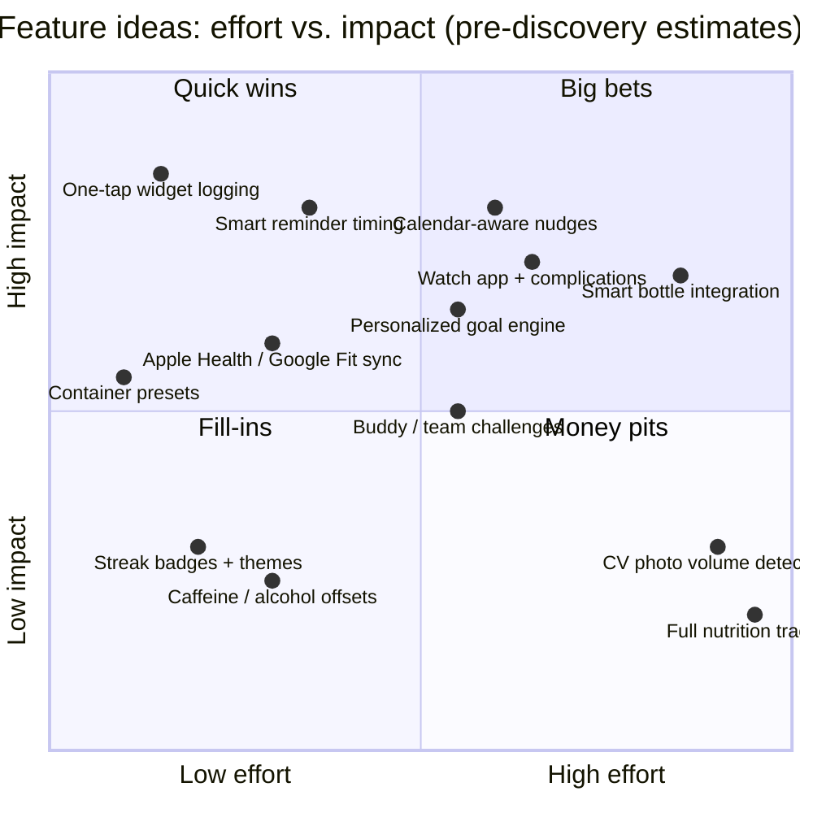

# Discovery Sprint Brainstorm: Hydration Habit App

> **Context:** Pre-discovery brainstorm for a mobile water-tracking app.
> **Target user:** Busy adults aged 25 to 40 who know they should drink more water but forget.
> **Status:** These are hypotheses to test in discovery, not validated findings. Every node here should end up confirmed, killed, or reframed by interviews and data.
> **Legend:** ⚡ **TENSION** marks a real strategic tradeoff the team needs to debate and decide on. These are collected in the [Tension Register](#-strategic-tension-register) at the bottom.

---

## Mindmap (overview)

---

## 1 · Core user jobs-to-be-done

**Primary JTBD statement (draft):**
> *When I'm heads-down in a busy workday, I want to drink enough water without having to remember or think about it, so I feel more energetic and in control of one simple health habit.*

| Job type | Job | Signal to look for in discovery |
|---|---|---|
| **Functional** | Get reminded at the moment I can actually act on it | Do people miss reminders, or get them and then can't act? |
| **Functional** | Know at a glance whether I'm on track today | How often do they check, and where (watch, widget, app)? |
| **Functional** | Have a target that fits my body, activity, and weather | Do users trust the default goal, or set their own? |
| **Emotional** | Feel I'm taking care of myself with low effort, an "easy win" | Language like "at least I did *one* thing right today" |
| **Emotional** | Avoid the afternoon realization: "I've had nothing but coffee" | Stories of headaches, fatigue, or the 3pm slump |
| **Social** | Do it with someone else (partner, team, friend) | Existing shared-goal behavior: fitness challenges, step competitions |
| **Underlying** | *Have the habit*, not *use the tracker* | Do past users say they "graduated" or that they "gave up"? |

> ⚡ **TENSION — Habit builder vs. ongoing tracker.** The real job is often to *become someone who drinks water*. If we do that job well, users may not need us any more. Are we a temporary coaching product with a planned graduation, or a permanent daily utility? The answer changes the north-star metric, the pricing model, and how we define retention. See T1.

**Hypotheses to test:**
- H1: The problem is **cue failure** (forgetting), not **motivation failure**. If it is motivation, reminders alone won't help.
- H2: Users care more about *feeling better* (energy, focus, skin, fewer headaches) than about *hitting millilitres*.
- H3: There are at least two distinct segments, the **Optimizers** (they like data, wear wearables, and want precision) and the **Forgetters** (they want zero effort and dislike logging). They may need different products.

---

## 2 · Key friction points in existing behavior

| Stage of the day | Friction | Severity (hypothesis) | Current workaround |
|---|---|---|---|
| **Cue** | Deep work and back-to-back meetings override thirst cues | 🔴 High | Big bottle on the desk, sticky notes |
| **Cue** | No water within reach when the reminder fires | 🔴 High | None. The reminder just gets dismissed |
| **Action** | Refilling takes a trip away from the desk | 🟡 Medium | Very large (1L+) bottles |
| **Logging** | Manual entry feels like a chore; people forget to log even when they drank | 🔴 High | They stop logging but keep drinking, so the data shows they failed |
| **Logging** | Guessing volumes ("was that 250 or 400ml?") | 🟡 Medium | Marked "time-line" bottles |
| **Motivation** | Benefits are invisible and delayed, so there's no immediate payoff | 🔴 High | Streaks, other people's encouragement |
| **Motivation** | Generic goals like "8 glasses" feel arbitrary and untrustworthy | 🟡 Medium | Ignore the goal |
| **Notifications** | Too many alerts lead to muting, and then the app becomes invisible | 🔴 High | Turn notifications off entirely |
| **Context** | Routine breaks (travel, weekends, gym days, sick kids) | 🟡 Medium | None; the habit collapses |
| **Data** | Hydration data is scattered across Apple Health, the wearable, and the app | 🟢 Low | Ignore |

> ⚡ **TENSION — Logging accuracy vs. logging friction.** Accurate data needs logging effort. Zero effort means rough data. Do we optimize for *precise data* (Optimizers, which also enables a premium analytics tier) or *"good enough" plus effortless* (Forgetters, the bigger market)? See T2.

> ⚡ **TENSION — Nudge intensity vs. notification fatigue.** Our core value is interrupting people, and interruptions are what get apps muted and deleted. The difference between "helpful" and "nagging" is narrow and varies by person. See T3.

---

## 3 · Feature ideas ranked by effort vs. impact

### Ranked backlog

Scores are 1 (low) to 5 (high). **Priority = Impact ÷ Effort**, with judgment applied afterward.

| Rank | Feature | Impact | Effort | Quadrant | Friction it addresses | Notes |
|---|---|---|---|---|---|---|
| 1 | **One-tap logging** (widget, lock screen, watch complication, Siri / Google Assistant) | 5 | 1 | Quick win | Logging chore | Probably the most important feature. Logging needs to take under 2 seconds. |
| 2 | **Container presets** ("my blue bottle = 750ml") | 3 | 1 | Quick win | Volume guessing | Cheap. Pairs with #1. |
| 3 | **Smart reminder timing** (adapts to logging patterns, quiet hours, snooze-to-later) | 5 | 2 | Quick win | Notification fatigue, bad timing | Begin rules-based, then make it adaptive. |
| 4 | **Health platform sync** (Apple Health / Google Health Connect) | 3 | 2 | Quick win | Scattered data | Expected baseline; brings in workout context. |
| 5 | **Calendar-aware nudges** ("you have 3 meetings in a row; drink now") | 5 | 3 | Big bet | Deep-work cue failure | Clear differentiator for the "busy" segment. Needs calendar permission, which raises trust and privacy questions. |
| 6 | **Personalized goal engine** (weight, activity, weather, caffeine) | 4 | 3 | Big bet | Arbitrary goals | ⚡ Must avoid medical claims (see T6). |
| 7 | **Watch app** | 4 | 3 | Big bet | Phone not at hand | High value for the Optimizer segment. |
| 8 | **Buddy / team challenges** | 3 | 3 | Big bet | Invisible benefits, motivation | Useful on-ramp to B2B (see section 4). |
| 9 | **Smart bottle integration** (third-party, or our own hardware) | 4 | 5 | Big bet | Logging chore (automatic) | ⚡ Integrate vs. build hardware (see T4). |
| 10 | Streak badges, themes | 2 | 1 | Fill-in | Motivation | Ship cheaply. ⚡ Streaks carry churn risk (see section 5). |
| 11 | Caffeine / alcohol "offsets" | 2 | 2 | Fill-in | Goal accuracy | Weak evidence base. Treat carefully. |
| 12 | CV photo volume detection | 2 | 5 | Money pit | Volume guessing | Harder than tapping a preset. Park it. |
| 13 | Full nutrition / food tracking | 2 | 5 | Money pit | — | ⚡ Scope creep into a crowded category (see T5). |

> ⚡ **TENSION — Focused utility vs. wellness platform.** Hydration alone is a narrow, low-willingness-to-pay job. Expanding into sleep, caffeine, or nutrition raises ARPU, but it also adds the complexity that busy, forgetful users dislike, and it puts us in competition with well-funded incumbents. See T5.

**Proposed MVP for discovery validation:** #1 + #2 + #3 + #4. Prototype #5 as a concierge or Wizard-of-Oz test (manually timed nudges based on a shared calendar) before building it.

---

## 4 · Monetization paths with tradeoffs

| Path | How it works | Pros | Cons / risks | Fit with target user |
|---|---|---|---|---|
| **A. Freemium subscription** | Free core tracking; premium ($2–5/mo) for smart nudges, calendar integration, insights, watch | Recurring revenue; category norm; easy to experiment with paywalls | Hydration has low perceived value, so conversion is likely low. ⚡ Paywalling the core value hurts the free experience (T7) | 🟡 Medium. Busy professionals will pay *if* it saves effort |
| **B. One-time premium unlock** | Pay once ($5–15) for everything | Low friction; fits a "habit, then graduate" model; builds trust | No recurring revenue; LTV caps early; hard to fund ongoing development | 🟢 Good for users, 🔴 hard for the business |
| **C. Hardware bundle** | Smart bottle plus app; margin on hardware and/or a subscription | Solves logging friction automatically; strong lock-in; premium positioning | Capital-intensive; inventory, returns, and support; slow iteration; must compete with established smart bottles | 🟡 Optimizers only. Forgetters won't buy a bottle |
| **D. B2B / employer wellness** | Sell seats to employers or wellness platforms; team challenges | Higher ACV; the buyer is not the user, so less price sensitivity; team features help retention | Long sales cycles; needs admin/reporting; "employer watching my health" raises privacy concerns; product roadmap gets pulled toward the buyer | 🟢 Strong. The target user is at work when the problem happens |
| **E. Ads / affiliate** | In-app ads; affiliate links for bottles and electrolytes | Monetizes the free tier; no paywall | Hurts a calm, low-effort experience; affiliate deals bias recommendations. ⚡ Using health data to target ads is a serious trust and policy risk | 🔴 Poor |
| **F. Data licensing** | Aggregated, anonymized hydration insights sold to brands or researchers | Potentially high-margin | 🔴 Trust, regulatory (e.g., HIPAA-adjacent, GDPR special-category health data, CCPA/CPRA), and platform-policy risk (platforms restrict how health data can be used). Recommend **ruling this out explicitly** | 🔴 Not recommended |

> ⚡ **TENSION — B2C vs. B2B as the primary path.** B2C freemium keeps the product user-centric but may never reach meaningful revenue for a low-WTP job. B2B employer wellness has better unit economics, but the buyer (HR) wants engagement reporting, which conflicts with user privacy and could turn a personal habit into workplace surveillance. Choosing one shapes the next 12 months of roadmap. See T7 and T8.

**Recommendation to pressure-test:** Start with **A (freemium)** to validate value and retention. Design team challenges (#8) so they could become a **D (B2B)** wedge later. Keep **C (hardware)** as integrate-only, not build. Rule out **E/F** in writing as a trust commitment and market differentiator.

---

## 5 · Retention risks and how to address them

| # | Risk | Likely timing | Leading indicator | Mitigation ideas |
|---|---|---|---|---|
| R1 | **Novelty decay.** The app feels exciting on day 1 and like a chore by day 14 | Weeks 2–4 | Logs per active day falling | Fewer taps (one-tap logging); vary the content of nudges; weekly "how you've felt" reflection that ties hydration to energy |
| R2 | **Notification muting.** User silences the app and it becomes invisible | Weeks 1–3 | Notification opt-out; reminder-to-log conversion falling | Adaptive frequency that backs off automatically; user-tunable "nudge personality"; ask before increasing frequency; widget as a passive, always-visible reminder |
| R3 | **Streak-break abandonment.** One missed day, streak resets, user gives up | Any time; spikes after weekends or travel | Churn in the 72h after a broken streak | Streak "freezes" or "rest days"; weekly goals instead of daily; frame it as "5 of 7 days" consistency, not perfection |
| R4 | **Logging fatigue.** User keeps drinking but stops logging, so the data says they failed | Weeks 2–6 | Long gaps between logs; logs bunched at the end of the day | Back-fill ("about how much did you drink this afternoon?"); passive inputs (bottle, watch); avoid shaming empty days |
| R5 | ⚡ **Success-driven churn.** The habit sticks and the user no longer needs the app | Months 2–4 | Churn among users with *high* goal attainment | Decide the strategy first (T1): either (a) design a "graduation" with low-touch maintenance mode and referral prompts, or (b) expand into adjacent jobs to stay useful (risks T5) |
| R6 | **Goal distrust.** The target feels arbitrary or unreachable, so the user disengages | Week 1 | Users editing their goal repeatedly or ignoring it | Explain *why* the goal is what it is; start with an achievable ramp-up goal; let users set their own |
| R7 | **Context breaks.** Travel, illness, or a routine change ends the habit | Event-driven | Sudden drop in activity after a stable period | "Travel mode" / "sick day" mode; re-engagement nudge built around a fresh start ("new week, new start") |
| R8 | **Guilt and shame loop.** A red "failed" UI makes the user feel bad, so they avoid the app | Ongoing | Lower open rate after bad days | Compassionate copy; celebrate partial progress; no red failure states |

> ⚡ **TENSION — Gamification vs. healthy behavior.** Streaks and challenges drive short-term engagement, but they can (a) cause the churn spikes in R3, (b) create guilt loops (R8), and (c) at the extreme, reward over-drinking, which is a real health risk (hyponatremia). Competitive team challenges make this worse. Engagement mechanics need guardrails such as daily caps and no rewards above a safe ceiling. See T9.

**North-star candidates to debate (tied to T1):**
- *Utility model:* Weekly active loggers hitting ≥ 5/7 days of their goal.
- *Coaching model:* % of users who reach a self-reported sustained habit by day 60. Churn after that point counts as success, not failure.

---

## ⚡ Strategic Tension Register

These need an explicit decision, with an owner and a deadline, before or during the discovery sprint. Leaving them implicit means they will be decided by default in sprint planning.

| ID | Tension | Option A | Option B | Why it matters | How discovery can inform it |
|---|---|---|---|---|---|
| **T1** | **Habit builder vs. permanent tracker** | Coach users to independence ("graduate") | Daily utility used indefinitely | Defines the north star, pricing (one-time vs. subscription), and what "churn" means | Interview lapsed users of competing apps: did they *graduate* or *give up*? |
| **T2** | **Precision vs. effortlessness** | Accurate logging for Optimizers | Rough, low-effort logging for Forgetters | Determines core UX, segment focus, and premium value | Segment-sizing survey; diary study of logging behavior |
| **T3** | **Nudge intensity vs. fatigue** | Proactive, frequent nudges (more drinking now) | Minimal, user-controlled nudges (longer retention) | Core value can damage the product if overdone | A/B test of reminder cadence measuring 30-day retention, not just day-1 logs |
| **T4** | **Integrate vs. build hardware** | Integrate third-party smart bottles | Build our own bottle | Capital, focus, and moat | Measure how many target users already own a smart bottle and would buy one |
| **T5** | **Focused utility vs. wellness platform** | Do one job very well | Expand to adjacent habits for ARPU and retention | Scope, competition, and simplicity for busy users | Test willingness to pay for hydration alone vs. a bundle (Van Westendorp pricing survey) |
| **T6** | **Personalization vs. medical claims** | Personalized targets based on body and health data | Generic, wellness-framed guidance | Personalized health guidance can create regulatory exposure (e.g., software-as-a-medical-device questions) and liability | **Legal/regulatory review before building** the goal engine. Get clinical advisor input on safe ranges |
| **T7** | **Generous free tier vs. paywall core value** | Free smart reminders (growth) | Paywall smart reminders (revenue) | The thing users most need is also our strongest paid hook | Paywall placement experiments; measure conversion *and* free-tier retention |
| **T8** | **B2C vs. B2B as primary path** | Consumer-first | Employer wellness first | Who we build for: the user or the HR buyer | 5–10 buyer interviews with HR/wellness leads running alongside user interviews |
| **T9** | **Engagement mechanics vs. health safety** | Streaks, leaderboards, competition | Consistency framing, caps, no competitive volume | Engagement may come at the cost of wellbeing or safety | Clinical advisor input; monitor for outlier intake in any beta |

### Suggested decision order
1. **T6** (regulatory guardrails) and **T9** (safety). These are constraints, not preferences, so settle them first.
2. **T1** (habit vs. tracker). This sets the north star and the business model.
3. **T8** (B2C vs. B2B). This sets who the customer is.
4. **T2 / T3 / T7** follow from the three above and can be tested with experiments.
5. **T4 / T5**: defer until there is evidence of retention.

---

## Discovery sprint: next steps
- [ ] Recruit 8–12 target users across both hypothesized segments (Optimizers / Forgetters), plus 4–6 lapsed users of existing hydration apps.
- [ ] Run a 5-day diary study on cue failure vs. logging failure (H1, T2).
- [ ] Wizard-of-Oz test of calendar-aware nudges with 5 users.
- [ ] 3–5 HR/wellness buyer conversations (T8).
- [ ] Legal/regulatory and clinical advisor review of goal personalization and engagement mechanics (T6, T9) **before** the PRD.
- [ ] Decide T1 and record the decision with its reasoning in `problem-hook.md`.

> *Reminder: This brainstorm was drafted with AI assistance. Have a human review it before using it in planning, and run all health-guidance and data-handling decisions past legal/compliance.*
