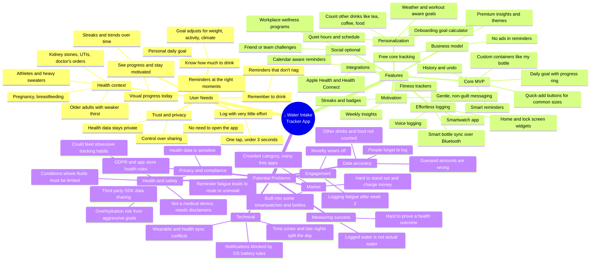

# Mindmap: Daily Water Intake Tracker (Mobile App)

> **Module 1 · Product thinking exercise.** A product mindmap for a mobile app that helps people track how much water they drink each day. It covers three areas: **user needs** (why people would use it), **features** (what we could build), and **potential problems** (what could go wrong).

## Mindmap

## Key takeaways

1. **Effort is the main enemy.** The biggest risk is that people stop logging, not that features are missing. Widgets, watch logging, and one-tap quick-add matter more than advanced analytics.
2. **Reminders can help or hurt retention.** Smart, context-aware reminders keep people using the app. Too many push people to mute it or uninstall. Reminder quality needs its own success metric.
3. **Personalization makes us different, and health safety limits it.** Goals that adapt to weather and activity are a real advantage. They need safe caps and clear medical disclaimers.
4. **The market is crowded and many apps are free.** Basic tracking won't win on its own. Our angle has to be a better habit loop with less effort.

## Open questions for discovery

- Which group feels the strongest pain: busy office workers, athletes, or people with medical guidance to drink more?
- Why do people stop using water trackers they already have, and when?
- How many reminders a day is too many?
- Would people pay for anything beyond basic tracking? If so, what?

## Draft success metrics

| Area | Metric |
|---|---|
| Activation | % of new users who log at least 3 times on day 1 |
| Engagement | Logging days per week (target ≥ 5) |
| Retention | Day 30 retention |
| Reminder health | Reminder → log conversion rate; % of users who mute notifications |
| Outcome (self-reported) | % of users who say they hit their goal more often after 4 weeks |
