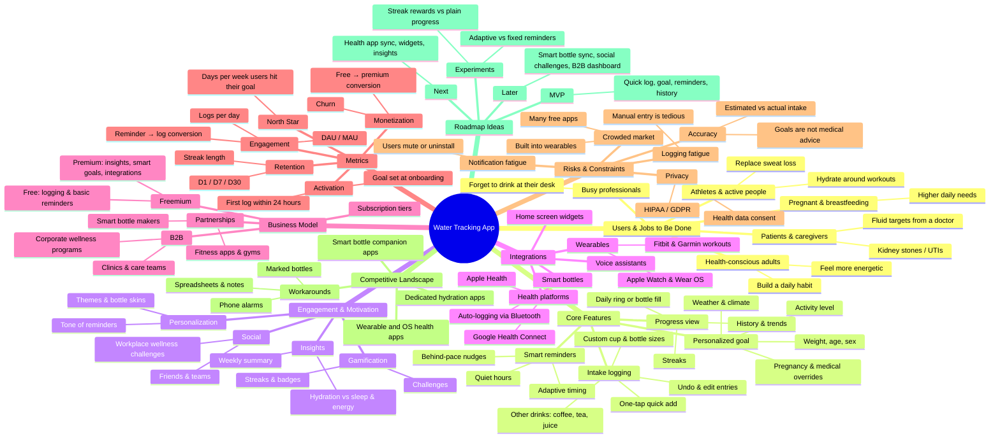

# Mindmap: Water Tracking App

> Brainstorming map for a hydration-tracking product concept. It sits next to `strategic-map.md` and feeds the problem hook, the discovery work, and the roadmap.

## How to use this map

- **Problem hook (M1):** Pick one branch under *Users & Jobs to Be Done* and one under *Risks & Constraints*. Together they give you a user and the pain they feel, e.g. busy professionals + logging fatigue.
- **Discovery (M2):** The *Competitive Landscape → Workarounds* branch lists the manual workarounds to check in interviews and journey mapping.
- **Analytics (M3):** The *Metrics* branch is a starting point for the north star metric and its supporting metrics.
- **Roadmap (M4) and experiments (M5):** The *Roadmap Ideas* branch splits work into MVP, next, and later, and lists two A/B test ideas.
